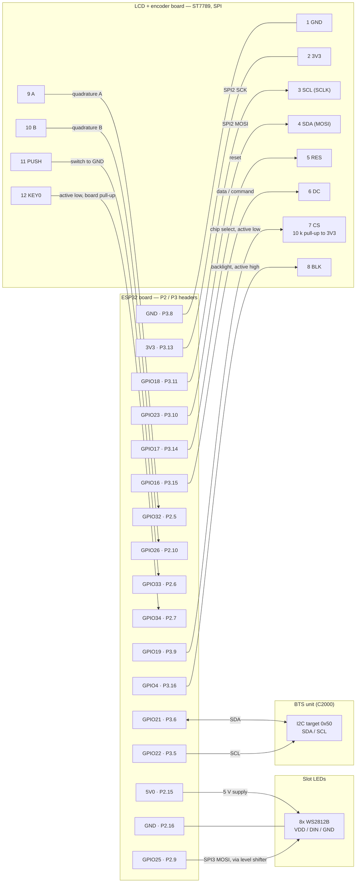

# ESP32 Hardware Connections

Which ESP32 pin goes where on the BTS proxy: the status LCD, the rotary
encoder and push switch, the extra KEY0 button and the eight slot LEDs. The
BTS I2C link and the console UART are included so the whole board is accounted
for.

**Source of truth is the firmware.** Every GPIO below is taken from
`esp32-btle-proxy/main/main.c` (the `#define`s and the `display_config_t`,
`input_config_t` and `led_strip_config_t` it builds), and **every one of them
has been verified on the bench**: the LCD, the encoder's A, B and PUSH, KEY0
and the slot LED strip all work on the pins shown.

### The pin map at a glance

| Function | GPIO | Header | Notes |
|---|---|---|---|
| LCD SCLK / MOSI | 18 / 23 | P3.11 / P3.10 | SPI2 (HSPI) |
| LCD CS / RES / DC / BLK | 19 / 17 / 16 / 4 | P3.9 / P3.14 / P3.15 / P3.16 | CS has an external 10 k pull-up |
| Encoder A / B / PUSH | 32 / **26** / 33 | P2.5 / P2.10 / P2.6 | B moved off GPIO27 |
| KEY0 | 34 | P2.7 | Input only. Press: back to the slot list. **Hold: e-stop, every slot off** |
| Slot LED data (WS2812B DIN) | **25** | P2.9 | SPI3 MOSI, 5V strip |
| BTS I2C SDA / SCL | 21 / 22 | P3.6 / P3.5 | |
| Console UART0 TX / RX | 1 / 3 | P3.2 / P3.3 | |

**Pins to stay away from on this board.** GPIO27, GPIO14 and GPIO13 gave no
usable signal on the bench (details under each function below). They may be
broken traces, damaged pads, or loaded by something on the board - nobody has
found out which - so treat them as suspect, not free.

The header positions (P2/P3) and the LCD board pin names come from the board
and the AliExpress module, not from the code, so they are the part to check
against the hardware if something does not respond.

Related: [`data-flow.md`](data-flow.md) for what travels over these links,
[`hardware-resources.md`](hardware-resources.md) for the C2000 side.

---

## Connection diagram

---

## LCD and rotary encoder board

ST7789 in SPI mode. The module is the one from
<https://www.aliexpress.com/item/1005008766561044.html>.

**Panel: 320x240, landscape.** The board was upgraded from the original
240x240 panel to a 240x320 one with the same ST7789 controller and the same
pinout. The firmware turns it 90 degrees counter-clockwise through the
controller (`rotation = 1` in `main.c`), so the UI is drawn as 320 wide by
240 high. The boot self-test shows a white square in the top-left corner and
"DISPLAY OK" along the long edge; if that reads upside down, set
`rotation = 3`, and if it reads back to front, set `mirror = true`.

| LCD board pin | Signal | ESP32 header | GPIO | Firmware use |
|---|---|---|---|---|
| 1 | GND | P3.8 | — | Ground |
| 2 | 3V3 | P3.13 | — | 3.3 V supply |
| 3 | SCL (SCLK) | P3.11 | **GPIO18** | SPI2 SCK |
| 4 | SDA (MOSI) | P3.10 | **GPIO23** | SPI2 MOSI. The bus is write-only; MISO is not assigned |
| 5 | RES | P3.14 | **GPIO17** | Panel reset |
| 6 | DC | P3.15 | **GPIO16** | Data / command select |
| 7 | CS | P3.9 | **GPIO19** | Chip select, active low, driven by the SPI driver. External 10 k pull-up to 3V3 installed |
| 8 | BLK | P3.16 | **GPIO4** | Backlight, active high. Held off until the first frame is drawn |
| 9 | A | P2.5 | **GPIO32** | Encoder channel A, decoded by PCNT |
| 10 | B | P2.10 | **GPIO26** | Encoder channel B, decoded by PCNT |
| 11 | PUSH | P2.6 | **GPIO33** | Encoder push switch, active low. Press selects, 800 ms long press goes back one menu level |
| 12 | KEY0 | P2.7 | **GPIO34** | Extra push button, active low. Returns the front panel to the slot list from any menu |

### Why these pins

All four of these pins were chosen from the free pins on the P2/P3 tables, and
none is a boot strapping pin (the straps are GPIO0, 2, 5, 12 and 15).

- **CS = GPIO19 (P3.9).** CS is an output, so it needs an output-capable pin.
  GPIO19 has no boot role, and it sits in the same run of header pins as the
  other LCD signals (P3.8 to P3.16), between LCD GND and MOSI. It is VSPI's
  default MISO pad, but nothing uses MISO: the LCD bus is write-only and the
  LED driver is MOSI-only.
- **KEY0 = GPIO34 (P2.7).** KEY0 is an input, so it takes an input-only pin
  and leaves the output-capable ones free. GPIO34 supports GPIO interrupts. It
  has **no internal pull-up or pull-down**, which does not matter because KEY0
  is already pulled up to 3V3 on the LCD board. GPIO35 (P2.8) is the same kind
  of pin and is the alternate.
- **Encoder A = GPIO32 (P2.5) and PUSH = GPIO33 (P2.6).** These replace GPIO15
  and GPIO2, which are both strapping pins. Neither new pin has a boot or JTAG
  role, and both have internal pull-ups, which PUSH needs because it has no
  external one. They sit next to each other and next to KEY0 on P2.
- **Encoder B = GPIO26 (P2.10).** An ordinary pin with a pull-up, and one that
  was seen toggling when probed. It replaces GPIO27, which never saw an edge on
  the bench.
- **Slot LED data = GPIO25 (P2.9).** An output-capable pin with no boot or JTAG
  role, verified by scope as a plain 1 Hz GPIO and then as SPI3 MOSI.

  Moving them does not change how the encoder is clocked. PCNT routes every
  input through the GPIO matrix, so no pin is faster than another. The
  decoding limits are the glitch filter in `input.c` and the contact bounce.

Rejected: GPIO0, 5 and 12 are strapping pins. GPIO14 and GPIO13 are JTAG pins
that gave no drive on the bench, and GPIO27 never saw an edge as an input; see
the notes under Encoder B and Slot LEDs.

### Pull-ups

| Line | External | Internal (firmware) | Idle level |
|---|---|---|---|
| A | pulled up to 3V3 on the board | enabled | high |
| B | pulled up to 3V3 on the board | enabled | high |
| PUSH | none known | enabled (`switch_active_low = true`) | high, low when pressed |
| KEY0 | pulled up to 3V3 on the board | none available on GPIO34 | high, low when pressed |
| CS | **10 k to 3V3, required. Installed** | none | high, deselected |

The internal pull-ups on A and B are redundant with the board's, and
harmless. They are there because PCNT never enables a pull itself, and a
module without its own pull-ups would otherwise read floating inputs.

### CS wiring

The module has **no tie from CS to GND**, so CS is a real input on the panel
and has to be driven. There is nothing to remove.

The external **10 k pull-up from CS to 3V3 is required, and is installed.**
GPIO19 is high-impedance from reset until the firmware configures it, and a
floating CS would leave the panel selected, or half selected, while the SPI
pads settle at boot. The pull-up holds it deselected until the driver takes
over.

---

## Slot LEDs

| Signal | ESP32 header | GPIO | Use |
|---|---|---|---|
| WS2812B VDD | P2.15 | — | **5V0** |
| WS2812B GND | P2.16 | — | GND, shared with the ESP32 |
| WS2812B DIN | P2.9 | **GPIO25** | SPI3 (VSPI) MOSI. One data line, eight LEDs in series, one LED per BTS slot, in reverse order (see below) |

**Why GPIO25.** A PCB layout error put the 5V pin one position off, and moving
DIN is what lines it up again. GPIO25 is an ordinary output-capable pin with no
boot or JTAG role, and it is **verified on the bench**: a scope saw it toggle at
1 Hz as a plain GPIO and then carry SPI3 MOSI bursts, and the strip lit.

The pins tried first, and why they were dropped:

- **GPIO13** was the original pin, and the one the layout error put out of line.
- **GPIO12** is MTDI, a boot strapping pin that picks the flash voltage (low is
  3.3 V, high is 1.8 V), so a level shifter that idles high would stop this
  board's 3.3 V module booting.
- **GPIO14** (MTMS) gave no drive on the bench: a scope saw nothing even with the
  pin driven as a plain GPIO. The pad may be damaged, or loaded by something on
  the board; it is worth a closer look before relying on it for anything.
- **GPIO35** cannot be an output at all - it is input-only.

**LED order is reversed.** LED 1, the first after DIN, shows slot 8, and
LED 8 shows slot 1. `led_for_slot()` in `led_strip.c` holds the mapping.

The strip is not on the LCD board. It has no clock line; the SPI3 bit
pattern at 3.2 MHz forms the WS2812B pulses (see `led_strip.h`).

**Level shifting.** The strip runs from 5 V, so its data input wants a high of
at least 0.7 x VDD, which is 3.5 V. The ESP32 drives 3.3 V, which is below
that. It works on some parts and fails on others, depending on temperature and
batch. Put a 5 V-powered buffer in the DIN line, such as a 74AHCT125 or
74HCT125 (one gate is enough) or a 74AHCT1G125, with a 330 ohm series resistor
at the strip end and a 100 to 470 uF capacitor across the strip supply.

**Current.** A WS2812B draws about 20 mA per colour channel, about 60 mA at
full white, so the strip would draw about 480 mA if every pixel went white at
full brightness. The firmware limits that two ways:

- It runs the strip at **10% brightness** (26 of 255), roughly 50 mA worst
  case. These are indicators, not lighting.
- That is also the driver's **hard ceiling** (`LED_STRIP_MAX_BRIGHTNESS` in
  `led_strip.h`). It is in the driver, not the caller, so no setting can exceed
  it: a larger value is clamped and logged.
- During a WiFi firmware update the strip is switched off entirely, and every
  slot is stopped, to keep the 5V rail up - see "Firmware updates" below.

**Check.** On a LOLIN32 the 5V0 pin is normally the USB supply rather than a
regulated rail, so confirm the strip still has power when the board runs from
the backup cell alone.

---

## ESP32 board pin usage

`ASSIGNED` is what the firmware does with the pin. A dash means nothing is
assigned and the pin is free.

### P2

| P2 | IO_NAME | ASSIGNED |
|---|---|---|
| 1 | 3V3 | — |
| 2 | EN | Reset |
| 3 | VP | — (GPIO36, input only) |
| 4 | VN | — (GPIO39, input only) |
| 5 | GPIO32 | **Encoder A** (LCD board pin 9) |
| 6 | GPIO33 | **Encoder PUSH** (LCD board pin 11) |
| 7 | GPIO34 | **KEY0** (LCD board pin 12). Input only, no internal pull |
| 8 | GPIO35 | — (input only) |
| 9 | GPIO25 | **WS2812B DIN**, SPI3 MOSI |
| 10 | GPIO26 | **Encoder B** (LCD board pin 10) |
| 11 | GPIO27 | — (encoder B was here; no edges seen on the bench) |
| 12 | GPIO14 | — (MTMS, JTAG. **No drive seen on the bench**) |
| 13 | GPIO12 | — (MTDI, strapping pin) |
| 14 | GPIO13 | — (JTAG MTCK. Inaccessible on the bench) |
| 15 | 5V0 | **WS2812B VDD** |
| 16 | GND | **WS2812B GND** |

### P3

| P3 | IO_NAME | ASSIGNED |
|---|---|---|
| 1 | GND | — |
| 2 | TXD0 | Console UART0 TX (AT console) |
| 3 | RXD0 | Console UART0 RX (AT console) |
| 4 | 3V3 | — |
| 5 | GPIO22 | **BTS I2C SCL** |
| 6 | GPIO21 | **BTS I2C SDA** |
| 7 | GND | — |
| 8 | GND | **LCD board GND** (pin 1) |
| 9 | GPIO19 | **LCD CS** (pin 7). External 10 k pull-up to 3V3 |
| 10 | GPIO23 | **LCD SDA / MOSI**, SPI2 (pin 4) |
| 11 | GPIO18 | **LCD SCL / SCLK**, SPI2 (pin 3) |
| 12 | GPIO5 | — (strapping pin) |
| 13 | 3V3 | **LCD board 3V3** (pin 2) |
| 14 | GPIO17 | **LCD RES** (pin 5) |
| 15 | GPIO16 | **LCD DC** (pin 6) |
| 16 | GPIO4 | **LCD BLK**, backlight (pin 8) |
| 17 | GPIO0 | — (download-mode strapping pin) |
| 18 | GND | — |
| 19 | GPIO2 | — (strapping pin; was Encoder PUSH) |
| 20 | GPIO15 | — (strapping pin, MTDO; was Encoder A) |

### By peripheral

| Peripheral | Signals | GPIOs |
|---|---|---|
| ST7789 LCD, SPI2 (HSPI) | SCLK, MOSI, RES, DC, BLK | 18, 23, 17, 16, 4 |
| ST7789 LCD chip select | CS | 19 |
| Rotary encoder + switch, PCNT | A, B, PUSH | 32, 26, 33 |
| KEY0 button | KEY0 | 34 |
| Slot LEDs, SPI3 (VSPI) | DIN | 25 |
| BTS link, I2C controller | SDA, SCL | 21, 22 |
| Console, UART0 | TX, RX | 1, 3 |
| **Free** | | 35 (input only, no internal pull), VP (36), VN (39) |
| **Not free: strapping** | | 0, 2, 5, 12, 15 |
| **Not free: suspect on this board** | | 13, 14 (JTAG pins, no drive seen on the bench); 27 (no edges seen as an input) |

---

## Things worth knowing

**Strapping pins.** None of the pins in use on the LCD, encoder, KEY0 or LED
connections is a strapping or JTAG pin: GPIO4, 19, 25, 26, 32, 33 and 34 have
no boot role. Encoder A and PUSH used to be on GPIO15 and GPIO2, both
strapping pins; moving them took the encoder out of the boot path.

**The LCD is on SPI2 using the VSPI pads.** GPIO23 and GPIO18 are the
IO_MUX defaults for SPI3 (VSPI), but the LCD uses SPI2 (HSPI) and reaches them
through the GPIO matrix. That keeps SPI3 free for the LEDs, so an LED frame
cannot stall a panel repaint. Do not "fix" the host back to VSPI.

**Encoder B moved twice.** B was on GPIO13 until the WS2812B driver took that
pin, then on GPIO27, and is now on **GPIO26**. On the bench the GPIO27 pad never
saw an edge - A, the switch and KEY0 all did, so the decoder was fine - and
GPIO26 was seen toggling when probed. Whether GPIO27 is a broken trace or a
damaged pad is not known.

**The panel is a write-only bus.** A wrong SPI mode or clock shows as a blank
or speckled panel, not an error. The current settings are SPI mode 0 at
10 MHz with a boot-time colour-bar self-test; `display_config_t` in `main.c`
holds them.

On the 320x240 panel the bring-up test cycle (`DISPLAY_TEST_CYCLE` in
`display.h`, where KEY0 steps through every mode and clock) showed **modes 0
and 3 working at both 10 MHz and 2 MHz, and modes 1 and 2 not at all**. That is
the ST7789 sampling on the rising clock edge, which only modes 0 and 3 give.
The 240x240 panel this board had before needed mode 2, so a panel swap can
change the answer - rerun the cycle if the new panel is ever dark.

**Colour inversion is off** (`invert_colour = false`). The old panel needed it
on. With it on, the 320x240 panel showed black as white and yellow as blue - a
photographic negative. If the picture is present but the colours are
complements of what they should be, flip that flag.

**The part number.** The module is an ST7789, which is what the driver
targets. If a datasheet or order page says ST7798, that is a transposition.

---

## Firmware updates and the power supply

**An OTA update browns the ESP32 out when the board runs on its backup cell
alone.** Measured on the bench, 2026-10-14: every upload reset the board about
4 s in, and the reset reason it kept was `BROWNOUT`. With USB connected, the
same upload completed. The radio transmits continuously and the flash is
erased and written throughout, which is the heaviest load this board sees.

So the firmware now sheds what load it can before an upload starts: the slot
LEDs are blanked and **every slot is stopped**. Both come back with the restart.
That helps; it does not fix a weak rail. Until the power path is strengthened,
**update with USB or a solid 5V supply connected.**

## Bring-up aids still in the firmware

All off by default or switchable, and kept because the pin map above came from
using them:

| Switch | File | What it does |
|---|---|---|
| `DISPLAY_TEST_CYCLE` | `display.h` | KEY0 steps the LCD through every SPI mode and clock, showing which one works |
| `DISPLAY_INPUT_HUD` | `display.h` | Draws `A1 B1 S1 K1 n0` (encoder pin levels, raw count) in the panel header. **Off** |
| `LED_STRIP_TEST_MODE` | `led_strip.h` | 1: toggles the data pin and three others at 1, 2, 4 and 8 Hz as a pin finder; 2: all white over SPI |

## Unconfirmed against the hardware

- **5V0 with the backup cell.** See the check under Slot LEDs.
- **Level shifter.** The strip lit on the bench. Whether it has a level shifter
  in the path is not recorded here, and a 3.3 V data line into a 5 V strip is
  still marginal on some parts, so keep one in the design.
- **Why GPIO13, GPIO14 and GPIO27 failed.** Not investigated. If the board has
  had a short or a hot-plug accident, check those pads before reusing them.
